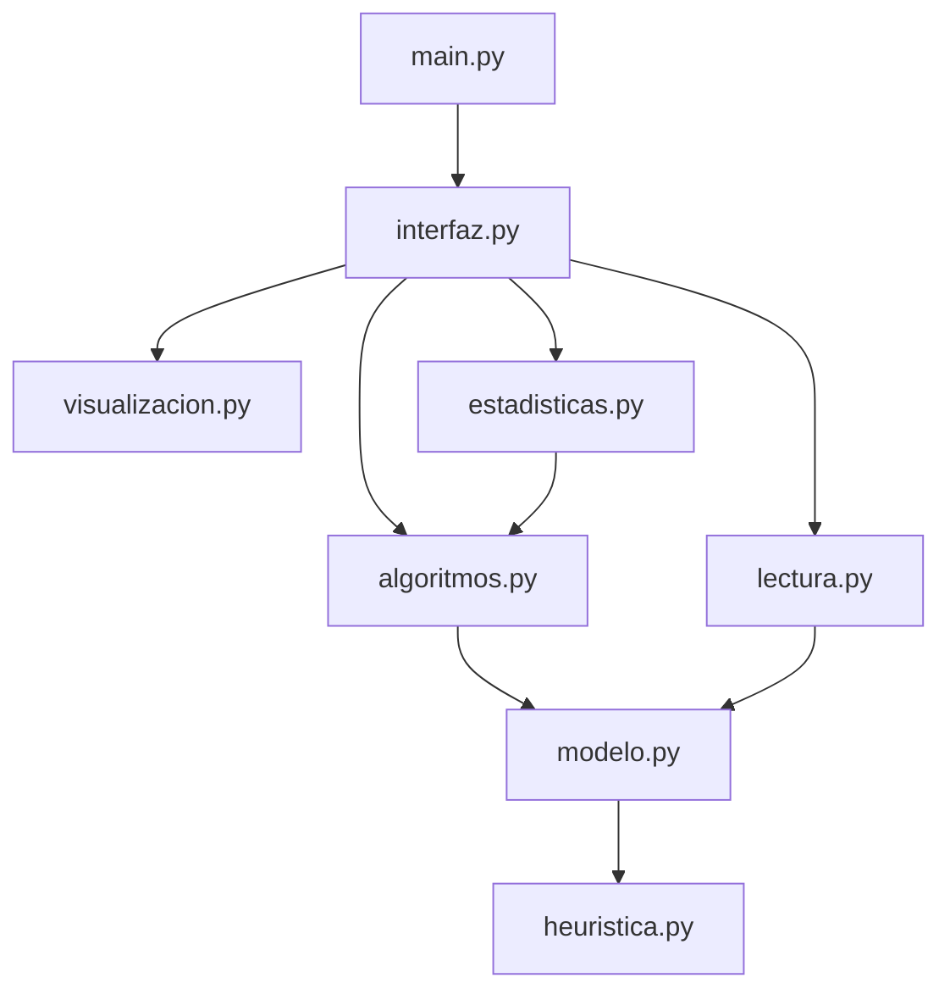

# Informe — Agente de Rescate con Víctimas en Riesgo
---

## Tabla de contenido

1. [Introducción y objetivo](#1-introducción-y-objetivo)
2. [Descripción del problema](#2-descripción-del-problema)
3. [Formulación formal](#3-formulación-formal)
4. [Representación del estado](#4-representación-del-estado)
5. [Espacio de búsqueda](#5-espacio-de-búsqueda)
6. [Función de costo g(n) y "mejor ruta"](#6-función-de-costo-gn-y-mejor-ruta)
7. [Heurística para A\* y demostración de admisibilidad](#7-heurística-para-a-y-demostración-de-admisibilidad)
8. [Algoritmos implementados](#8-algoritmos-implementados)
9. [Garantías de terminación](#9-garantías-de-terminación)
10. [Arquitectura del software](#10-arquitectura-del-software)
11. [Interfaz gráfica](#11-interfaz-gráfica)
12. [Pruebas y resultados](#12-pruebas-y-resultados)
13. [Análisis y discusión](#13-análisis-y-discusión)
14. [Limitaciones y mejoras futuras](#14-limitaciones-y-mejoras-futuras)
15. [Conclusiones](#15-conclusiones)

---

## 1. Introducción y objetivo

Una zona de desastre se modela como una cuadrícula 2D. Un agente de rescate debe moverse por ella para salvar al mayor número posible de víctimas. Cada víctima tiene un **tiempo de supervivencia** medido en *ticks*, y cada movimiento del agente consume exactamente 1 tick. Como el agente solo avanza una celda por tick y varias víctimas tienen tiempos muy cortos, normalmente **no todas pueden salvarse**.

El objetivo del proyecto es **implementar desde cero y comparar cuatro estrategias de búsqueda**, para encontrar la ruta que maximiza el número de víctimas rescatadas:

| Tipo | Algoritmos |
|---|---|
| No informada | Búsqueda en amplitud (**BFS**), Costo uniforme (**UCS**), Profundidad iterativa (**IDDFS**) |
| Informada | **A\*** con heurística admisible |

El sistema incluye una interfaz gráfica en Tkinter que anima la simulación tick a tick y muestra una tabla comparativa de los algoritmos.

---

## 2. Descripción del problema

**Entradas**

- `mapa.txt`: cuadrícula con `#` (pared), `.` (celda libre) y `S` (inicio del agente). También se aceptan `V` y dígitos como marcas de víctima (se tratan como celda libre; la posición real sale de `victimas.txt`).
- `victimas.txt`: una línea por víctima con formato `id,fila,columna,ticks_supervivencia[,critica]`. La quinta columna es opcional y marca víctimas críticas (`1`, `si`, `true`, `critica`, `x`).

**Ejemplo del enunciado**

```
##########
#S...#...#
#.##.#.#.#
#....#.#.#
#.##...#.#
#....#...#
##########
```

| id | fila | columna | ticks |
|----|------|---------|-------|
| V1 | 1 | 4 | 5 |
| V2 | 3 | 7 | 12 |
| V3 | 5 | 2 | 3 |
| V4 | 2 | 8 | 20 |
| V5 | 4 | 5 | 7 |

> Observación: en este ejemplo **V2 está sobre una pared** (fila 3, columna 7 es `#`). El sistema no lo trata como error fatal: emite una advertencia y esa víctima se cuenta como fallecida desde el tick 0 (ver §10.3).

**Reglas del entorno**

- *Duras:* no se puede entrar a una pared; el agente **no puede esperar** (cada turno se mueve); una víctima muere si el tick actual supera su tiempo de supervivencia; se rescata automáticamente al pisar su celda si sigue viva.
- *Blandas (implementadas):* entre rutas con igual número de rescates se prefiere la que salva más **víctimas críticas**, y luego la más corta.

---

## 3. Formulación formal

| Elemento | Definición |
|---|---|
| **Estado** | `(fila, columna, vivas, tick, rescatadas)` |
| **Estado inicial** | Agente en `S`, todas las víctimas vivas (salvo las que están sobre pared), `tick = 0` |
| **Acciones** | Mover N, S, E, O (orden fijo → resultados deterministas). Costo: 1 tick |
| **Modelo de transición** | Mover a una celda libre, `tick ← tick + 1`; se rescata la víctima de esa celda si `tick ≤ ticks(v)`; mueren las víctimas con `tick > ticks(v)` |
| **Prueba de meta** | No queda ninguna víctima viva **alcanzable** |
| **Costo** | `g(n) = (muertas, muertas_críticas, ticks)`, comparado lexicográficamente |

**Prueba de meta, en detalle.** Un estado es meta si, para toda víctima viva `v`, la **distancia real** (con paredes) del agente a `v` es mayor que sus ticks restantes:

```
distancia_real(agente, v) > ticks(v) − tick_actual      para toda v ∈ vivas
```

Esto cubre los casos "todas rescatadas" y "todas muertas", y además detecta pronto que las que quedan ya son imposibles de salvar. Las distancias reales se precalculan una sola vez con un BFS desde cada víctima (`_distancias_desde`), de modo que la prueba de meta cuesta O(|vivas|).

---

## 4. Representación del estado

El estado es un `NamedTuple` (`Estado`), por lo tanto **explícito, inmutable y hasheable**: sirve directamente como elemento de `set` (visitados) y dentro de tuplas en `heapq` (colas de prioridad).

```python
class Estado(NamedTuple):
    fila: int
    columna: int
    vivas: FrozenSet[int]       # índices de víctimas que ni murieron ni fueron rescatadas
    tick: int                   # movimientos realizados
    rescatadas: FrozenSet[int]  # índices de víctimas ya rescatadas
```

### ¿Por qué se agrega el campo `rescatadas`?

El enunciado define el estado como `(fila, columna, vivas, tick)`. Con solo esos campos, dos caminos distintos pueden llegar a **la misma posición, el mismo tick y el mismo conjunto de vivas** habiendo rescatado conjuntos *diferentes* (por ejemplo, una víctima pudo haber muerto en un camino y haber sido rescatada en otro, y en ambos casos ya no está "viva"). Si se trataran como el mismo estado, el conjunto de visitados descartaría uno de ellos y se **perdería información de valor distinto**. Con `rescatadas` el estado distingue ambos casos y la optimalidad se conserva.

Se usan `frozenset` porque son hasheables e inmutables, a diferencia de `set`.

---

## 5. Espacio de búsqueda

### 5.1 Factor de ramificación y profundidad

- **Factor de ramificación:** b ≤ 4 (N, S, E, O), menos las direcciones bloqueadas por paredes.
- **Profundidad máxima:** `tick_maximo = max(ticks de las víctimas) + 1`. Pasado ese tick todas las víctimas están muertas, y el estado es meta, por lo que no se expande más.

### 5.2 Tamaño del espacio

Cada estado queda determinado por la posición, el tick y qué víctimas fueron rescatadas (las vivas se deducen del tick y la posición). Una cota superior razonable es:

```
|S| ≤ (filas · columnas) · (tick_maximo + 1) · 2^k        (k = número de víctimas)
```

Es **finito**, lo que garantiza que las búsquedas con conjunto de visitados terminan. El factor `2^k` es el que hace crecer el problema cuando hay muchas víctimas, aunque en la práctica la mayoría de esos subconjuntos no son alcanzables porque los tiempos de supervivencia podan el espacio.

### 5.3 Observación sobre el tick

Como cada acción incrementa el tick en 1, **la profundidad de un nodo es igual a su tick**. Esto simplifica el análisis: los niveles de BFS son ticks y el límite de profundidad de IDDFS es un límite de ticks. Además, un mismo estado (que incluye el tick) siempre aparece a la misma profundidad.

---

## 6. Función de costo g(n) y "mejor ruta"

El objetivo es **maximizar las víctimas rescatadas**, no llegar a una celda concreta. Para poder usar UCS y A* (que minimizan un costo) se minimiza el número de víctimas perdidas, con desempates:

```
g(n) = ( muertas , muertas_críticas , ticks )     ← comparación lexicográfica
```

| Componente | Significado | Rol |
|---|---|---|
| `muertas` | Víctimas no rescatadas | Objetivo principal |
| `muertas_críticas` | De esas, las marcadas como críticas | Restricción blanda: se prefiere salvar a las críticas |
| `ticks` | Duración de la ruta | Desempate final: se prefiere la ruta más corta |

**Detalles que importan**

- `g` depende **únicamente del estado** (mismas rescatadas/vivas/tick ⇒ mismo g), no del camino. Por eso el conjunto de visitados no rompe la optimalidad.
- En un estado **meta**, las víctimas vivas restantes (inalcanzables) se cuentan como perdidas, de modo que `g(meta) = total − rescatadas`, el valor exacto del objetivo.
- Las componentes de `g` **nunca decrecen** al avanzar (las muertas solo aumentan y el tick sube 1), requisito para que UCS y A* sean óptimos.

---

## 7. Heurística para A\* y demostración de admisibilidad

### 7.1 Definición

```
h(n) = ( c , c_críticas , 0 )
```

donde `c` es el número de víctimas **vivas** en `n` que están **condenadas**:

```
Manhattan(agente, v) > ticks_restantes(v) = ticks(v) − tick_actual
```

y `c_críticas` cuenta cuántas de esas son críticas. En un estado meta, `h = (0, 0, 0)`.

La heurística no es la distancia Manhattan a "una meta" (hay varias víctimas, cada una con su plazo), sino una **estimación de las muertes ya inevitables**.

### 7.2 Demostración de admisibilidad

Se debe probar que `h(n) ≤ h*(n)`, donde `h*(n)` es el costo real restante óptimo.

**Sea** `v` una víctima viva y condenada en `n`: `Manhattan(pos, v) > r`, con `r = ticks(v) − tick_actual`.

1. Para llegar a `v`, el agente necesita al menos tantos movimientos como la **distancia real** entre su posición y `v`.
2. La distancia real es **≥ Manhattan**: las paredes solo pueden alargar el camino, nunca acortarlo, y el agente no puede moverse en diagonal.
3. Por lo tanto el agente necesitaría **más de `r` movimientos**, y llegaría cuando el tick ya superó `ticks(v)`.
4. Entonces `v` **no puede ser rescatada desde `n`**, sin importar la ruta que se siga.

Consecuencia: en **cualquier** meta alcanzable desde `n`, las víctimas ya muertas en `n` (contadas en `g`) más las `c` condenadas (conjunto disjunto, pues las condenadas están *vivas*) estarán perdidas. Luego:

```
costo real restante ≥ c = h(n)
```

La heurística nunca sobreestima, así que es **admisible**. Las componentes 2 y 3 se justifican igual: contar solo críticas condenadas y 0 ticks adicionales son cotas inferiores válidas. **∎**

### 7.3 Monotonía de f (consistencia práctica)

El código marca un estado como visitado **al generarlo** (no al expandirlo), lo cual exige que la primera vez que se genera un estado sea con su mejor `f`. Esto se cumple porque `f = g + h` **no decrece** a lo largo de cualquier camino:

- Una víctima condenada seguirá condenada en el siguiente paso: la distancia Manhattan baja a lo sumo 1 y los ticks restantes bajan exactamente 1, así que `Manhattan − restantes` no disminuye.
- Si una condenada muere, `g` sube 1 y `h` baja 1 → `f` no cambia.
- Una víctima rescatada nunca estaba condenada (llegó a tiempo), así que no altera `h` ni `g`.
- El tick (tercera componente) sube 1 en cada paso.
- Al llegar a una meta, `h = 0` y `g` pasa a contar todas las inalcanzables, lo que solo puede aumentar `f`.

Por lo tanto `f` es monótona no decreciente, y A\* con conjunto cerrado devuelve la **primera meta extraída como óptima**.

### 7.4 Informatividad y posibles mejoras

`h` es barata de calcular (O(|vivas|)) pero **débil**: solo detecta víctimas ya perdidas. Versiones más informadas serían usar la distancia real precalculada en lugar de Manhattan (sigue siendo admisible y detecta más condenadas), o añadir un término que considere que dos víctimas lejanas entre sí no pueden salvarse las dos en el tiempo disponible.

---

## 8. Algoritmos implementados

Todos heredan de `AlgoritmoBusqueda`, que centraliza el cronómetro, los contadores, el registro de la mejor meta y la construcción del `Resultado`. Cada subclase solo implementa `_buscar()`.

### 8.1 Clase base

- `_reiniciar()` pone en cero contadores y banderas para que una ejecución no contamine la siguiente.
- `_vencido()` consulta `time.perf_counter()` (reloj monótono) en **cada nodo**; al superar el límite fija `agotado = True`.
- `_registrar(nodo, es_meta)` guarda la **mejor meta** (menor `g`) y, como respaldo, el **mejor estado parcial** (clave `(-rescatadas, -críticas_rescatadas, tick)`), que se devuelve si el tiempo se agota antes de hallar una meta.
- `_construir_resultado()` reconstruye el camino recorriendo los punteros `padre` hasta la raíz.
- `Nodo` usa `__slots__` (estado, padre, acción) para ahorrar memoria.

### 8.2 BFS — Amplitud

| | |
|---|---|
| Estructura | Cola FIFO (`deque`) + conjunto de visitados |
| Particularidad | **No se detiene en la primera meta**: el objetivo es maximizar rescates, no llegar a "una" meta. Explora todo el espacio finito y conserva la mejor meta vista |
| Metas | Son terminales (no se expanden) |
| Completo / óptimo | Completo; óptimo porque revisa todo el espacio |
| Costo | Es el que más nodos expande entre BFS/UCS/A\*, pues ignora el costo |

### 8.3 UCS — Costo uniforme

| | |
|---|---|
| Estructura | Cola de prioridad (`heapq`) ordenada por `g(n)` + visitados |
| Desempate | Contador de inserción (evita comparar `Nodo`, que no es ordenable) |
| Detención | La **primera meta extraída** es óptima (g es monótono) |
| Ventaja | Poda todo lo que cuesta más que la mejor solución; expande muchos menos nodos que BFS |

### 8.4 IDDFS — Profundidad iterativa

| | |
|---|---|
| Estructura | DFS con límite `L = 0, 1, 2, …` usando **pila explícita** (sin recursión, no hay riesgo de `RecursionError`) |
| Profundidad | Igual al tick |
| Orden | Se apila con `reversed(...)` para que el primer sucesor (N) se explore primero |
| Visitados | Uno **por iteración**; es válido porque un estado (con su tick) aparece siempre a la misma profundidad |
| Terminación | Cuando una iteración completa no corta ninguna rama por el límite (a más tardar con `L = tick_maximo`) o se agota el tiempo |
| Costo | Reexpande los niveles superiores en cada iteración → **más nodos expandidos** que los demás, a cambio de memoria O(b·d) |

### 8.5 A\*

| | |
|---|---|
| Estructura | `heapq` con tuplas `(f, h, contador, nodo, es_meta)` + visitados |
| Evaluación | `f = g + h`, sumando las tuplas componente a componente |
| Desempate | Menor `h` (nodo "más avanzado") y luego orden de inserción |
| Detención | La **primera meta extraída** es óptima (h admisible, f monótona) |
| Ventaja | La heurística descarta ramas con víctimas condenadas: menos nodos que UCS |

### 8.6 Resumen comparativo

| Algoritmo | Estructura | Informada | Óptimo aquí | Memoria | Observación |
|---|---|---|---|---|---|
| BFS | Cola FIFO | No | Sí | Alta | Recorre todo el espacio |
| UCS | Cola de prioridad | No | Sí | Media-alta | Se detiene en la primera meta |
| IDDFS | Pila + límite | No | Sí | Baja | Reexpande nodos |
| A\* | Cola de prioridad | Sí | Sí | Media | Generalmente el que menos expande |

---

## 9. Garantías de terminación

Se implementaron **dos capas independientes** contra bucles infinitos:

1. **Espacio finito.** El tick crece 1 por movimiento; pasado `tick_maximo` todas las víctimas están muertas y el estado es meta (no se expande). Además todos los algoritmos usan conjunto de visitados.
2. **Límite de tiempo de 10 s** (`LIMITE_TIEMPO_SEGUNDOS`) para todos: en cada nodo se consulta el reloj y, al vencer, se corta la búsqueda y se devuelve el mejor resultado hallado hasta ese momento, con la bandera `tiempo_agotado = True`. La interfaz lo indica con un asterisco `*` en la tabla y un aviso de "resultado parcial".

---

## 10. Arquitectura del software

### 10.1 Módulos

| Archivo | Responsabilidad |
|---|---|
| `main.py` | Punto de entrada: crea `Aplicacion` y ejecuta `mainloop()` |
| `interfaz.py` | Ventana Tkinter: paneles, hilo de trabajo, animación |
| `visualizacion.py` | `MapaCanvas`: dibuja mapa, víctimas y agente en el `Canvas` |
| `estadisticas.py` | Construye el texto del panel "Resultado" y "Comparación" |
| `algoritmos.py` | `Nodo`, `Resultado`, clase base y los 4 algoritmos + fábrica `ejecutar()` |
| `heuristica.py` | `calcular_heuristica()`: separada para facilitar su estudio y sustentación |
| `modelo.py` | `Victima`, `Estado`, `Mapa`, `ProblemaRescate` (usado por la aplicación) |
| `lectura.py` | `cargar_mapa`, `cargar_victimas`, `validar_victimas` |
| `estado.py`, `mapa.py`, `victima.py`, `problema.py` | Versión del modelo dividida en un archivo por clase |

> **Nota:** el modelo existe en dos formas equivalentes: monolítica (`modelo.py`) y dividida (`estado.py`, `mapa.py`, `victima.py`, `problema.py`). La aplicación importa actualmente de `modelo.py`. Para la entrega conviene dejar **una sola** (la modular es la más limpia, y bastaría cambiar los `import` de `algoritmos.py`, `interfaz.py` y `lectura.py`) y así evitar código duplicado.

### 10.2 Diagrama de dependencias



### 10.3 Lectura y validación de archivos

- El mapa debe ser **rectangular**, tener caracteres válidos y **exactamente una `S`**; de lo contrario se lanza `ErrorDeArchivo`.
- En `victimas.txt` la cabecera es opcional, se ignoran líneas vacías y comentarios `//`, y se validan: al menos 4 campos, enteros válidos, ticks no negativos e ids no repetidos.
- Víctima **fuera del mapa** → error. Víctima **sobre una pared** → advertencia: es inalcanzable y se cuenta como fallecida desde el tick 0 (en `estado_inicial` no entra al conjunto de vivas).

### 10.4 Decisiones de diseño

- **Estado inmutable** (`NamedTuple` + `frozenset`) para usarlo en `set` y `heapq`.
- **Precálculo de distancias reales** con BFS por víctima, para que `es_meta` sea rápida.
- **Orden fijo de acciones** `N, S, E, O` → ejecuciones deterministas y reproducibles.
- **Heurística en módulo propio** y `ProblemaRescate.heuristica` solo delega.
- **Algoritmos en una jerarquía de clases** (patrón plantilla): el código común no se repite.

---

## 11. Interfaz gráfica

Implementada **solo con Tkinter/ttk** (sin frameworks externos), con cinco paneles:

1. **Carga de archivos:** botones *Examinar…* para `mapa.txt` y `victimas.txt`, con la ruta y un indicador de lectura (verde = correcto, rojo = error, naranja = aviso).
2. **Configuración:** menú desplegable de algoritmo (BFS, UCS, IDDFS, A\*), control deslizante de velocidad (50–1500 ms por tick) y casilla para ejecutar también los demás algoritmos.
3. **Botón "Iniciar Rescate":** se habilita solo cuando ambos archivos son válidos.
4. **Simulación animada:** la cuadrícula se actualiza tick a tick.
5. **Estadísticas:** cuadro con el resultado de la simulación y la tabla comparativa.

**Código de colores del mapa**

| Elemento | Color |
|---|---|
| Agente (`A`) | Azul |
| Víctima viva (con ticks restantes visibles) | Amarillo |
| Víctima rescatada | Verde |
| Víctima muerta | Rojo |
| Pared | Gris oscuro |
| Celdas ya recorridas | Azul claro (rastro) |

Las víctimas críticas se marcan con `*`. Cuando el agente está sobre una víctima se dibuja solo un aro para no taparla.

**Concurrencia.** Los algoritmos corren en un **hilo secundario** (`threading`) para que la ventana no se congele. El hilo deposita sus resultados en una `queue.Queue` y la interfaz la consulta cada 80 ms con `after`, que es el mecanismo seguro porque Tkinter no admite actualizarse desde otros hilos. Mientras hay una ejecución en curso se bloquean el botón de inicio y los selectores de archivo.

**Animación.** `_paso()` dibuja un estado del `camino`, actualiza el contador de tick y reprograma el siguiente con `after`. Al llegar al último estado se marca la simulación como terminada y se muestran las estadísticas finales.

---

## 12. Pruebas y resultados

### 12.1 Caso del enunciado

Se ejecutaron los cuatro algoritmos sobre el mapa y las víctimas de ejemplo (límite de 10 s):

| Algoritmo | Nodos expandidos | Nodos generados | Tiempo | Rescatadas | Fallecidas | Ticks |
|---|---:|---:|---:|---:|---:|---:|
| BFS | 383 | 383 | 0.003 s | 3 | 2 | 14 |
| UCS | 77 | 108 | 0.001 s | 3 | 2 | 14 |
| IDDFS | 3377 | 3377 | 0.025 s | 3 | 2 | 14 |
| **A\*** | **47** | 72 | 0.001 s | 3 | 2 | 14 |

*(Los tiempos dependen de la máquina; el número de nodos es determinista.)*

**Ruta óptima encontrada** (igual en los cuatro): `EEESSSEENNNEES` — 14 movimientos.

| Tick | Posición | Evento |
|---:|---|---|
| 3 | (1,4) | Rescata **V1** (límite 5) |
| 7 | (4,5) | Rescata **V5** (límite 7) |
| 14 | (2,8) | Rescata **V4** (límite 20) |

- **V2** estaba sobre una pared (3,7): inalcanzable, cuenta como fallecida.
- **V3** (5,2), límite 3: la distancia desde `S` es 5 > 3, queda condenada desde el inicio.

Resultado: **3 rescatadas, 2 fallecidas**, que coincide con el ejemplo del enunciado.

### 12.2 Verificación de la correcta operación

- Los cuatro algoritmos llegan al **mismo valor óptimo** (3 rescatadas), como se espera: BFS e IDDFS exploran todo, y UCS y A\* son óptimos por construcción.
- A\* y UCS expanden mucho menos que BFS e IDDFS, lo que confirma el efecto del costo y de la heurística.

### 12.3 Casos adicionales recomendados

| Caso de prueba | Resultado esperado |
|---|---|
| Archivo de mapa con filas de distinto largo | `ErrorDeArchivo` (mapa no rectangular) |
| Mapa sin `S` o con dos `S` | `ErrorDeArchivo` |
| Víctima fuera del mapa | `ErrorDeArchivo` |
| Víctima sobre pared | Advertencia; se cuenta como fallecida |
| Id de víctima repetido / ticks negativos | `ErrorDeArchivo` |
| Todas las víctimas inalcanzables desde el inicio | El estado inicial ya es meta; 0 rescatadas |
| Mapa grande con muchas víctimas | Se activa el límite de 10 s y se muestra resultado parcial (`*`) |
| Víctimas críticas con tiempos en conflicto | Entre rutas con igual número de rescates gana la que salva más críticas |

---

## 13. Análisis y discusión

**Calidad de la solución.** Los cuatro algoritmos encuentran la misma cantidad de rescatadas en el ejemplo. La diferencia está en el **esfuerzo**:

- **BFS** recorre el espacio completo porque debe confirmar que no hay una meta mejor; no usa ninguna información de costo.
- **UCS** ordena por `g`, así que se detiene en cuanto extrae la primera meta, y poda con ello gran parte del espacio.
- **IDDFS** es el más costoso en nodos (3377 vs. 47 de A\*) por reexpandir en cada iteración, pero es el de menor uso de memoria, ventaja que importa si el espacio crece.
- **A\*** es el más eficiente: la heurística identifica víctimas ya condenadas y prioriza ramas sin pérdidas inevitables.

**Complejidad.** Con factor de ramificación `b` y profundidad `d = tick_maximo`, BFS, UCS y A\* son O(bᵈ) en el peor caso en tiempo y memoria (acotados por el espacio de estados finito con visitados); IDDFS es O(bᵈ) en tiempo y O(b·d) en memoria de pila. En la práctica el tamaño real lo limita `(celdas · ticks · 2ᵏ)`.

**Efecto de las restricciones blandas.** Al meter `muertas_críticas` y `ticks` en `g`, la misma búsqueda produce rutas que salvan primero a las críticas y, a igualdad, la más corta, sin lógica adicional.

**Límite de tiempo.** Sirve de red de seguridad en instancias grandes: si BFS, UCS, IDDFS o A\* no terminan en 10 s, la interfaz muestra el mejor estado parcial hallado, marcado claramente como incompleto.

---

## 14. Limitaciones y mejoras futuras

- **Heurística débil.** Solo cuenta víctimas ya condenadas; sirve para podar, pero no guía activamente hacia víctimas salvables. Una versión con distancias reales precalculadas, o una cota basada en cuántas víctimas caben realmente en el tiempo restante, reduciría aún más los nodos expandidos.
- **Crecimiento exponencial** con el número de víctimas (factor `2ᵏ`): mapas muy grandes dependen del límite de tiempo.
- **Duplicación de código:** unificar `modelo.py` y los archivos modulares (§10.1).
- **Dominio:** podrían añadirse costos por terreno, múltiples agentes o víctimas que se muevan.

---

## 15. Conclusiones

1. El problema se modeló como una **búsqueda en un espacio de estados finito** con estado explícito, inmutable y hasheable, donde el campo adicional `rescatadas` evita mezclar estados de valor distinto.
2. La función `g(n) = (muertas, muertas_críticas, ticks)` convierte "maximizar rescates" en un problema de **minimización**, e incorpora las restricciones blandas de forma natural.
3. La heurística `h(n)` (víctimas condenadas por distancia Manhattan) es **admisible**, como se demostró, y además hace a `f` monótona, lo que justifica la optimalidad de A\* con conjunto de visitados.
4. Los cuatro algoritmos obtienen la solución óptima; **A\* es el más eficiente** en nodos expandidos y **IDDFS el menos**, con BFS y UCS en el medio, según lo esperado en la teoría.
5. La aplicación cumple con una interfaz Tkinter responsiva (hilo + cola), animación tick a tick, validación de entradas y tabla comparativa, con protección doble contra ejecuciones infinitas.
